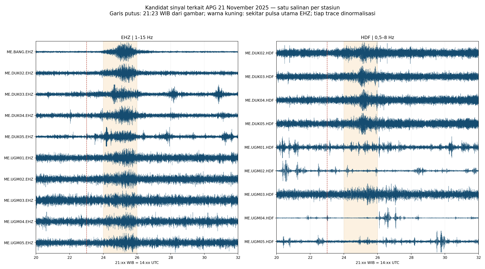

# Pemeriksaan event APG Merapi — 21 November 2025, 21:23 WIB

## Kesimpulan

Sinyal yang konsisten dengan event pada gambar terlihat pada jaringan AM dan ME. Tidak dapat dinyatakan terekam di semua jaringan dalam arsip: GE dan GF tidak memiliki file November 2025. DUK01 juga tidak memiliki file 21 November.

EHZ memperlihatkan pulsa bersama sekitar 21:24–21:26 WIB pada BANG, DUK02–DUK05, dan UGM01–UGM05; amplitudo relatif lebih kecil pada UGM. HDF jelas pada DUK02–DUK05 dan lebih lemah pada UGM03. HDF UGM01, UGM02, UGM04, dan UGM05 belum dapat diatribusikan dengan tegas kepada APG ini.

Ini adalah penilaian kesesuaian waktu dan bentuk sinyal, belum konfirmasi sumber melalui lokasi/beamforming. Puncak impulsif pada satu HDF tidak otomatis dianggap APG.

## Waktu acuan

Gambar pengguna menunjukkan 21 November 2025 sekitar 21:23 WIB; waktu CCTV pada tangkapan sekitar 21:23:55–57. WIB = UTC + 7 jam, sehingga pencarian berpusat di 14:23 UTC. Judul video bukan penentuan onset presisi.

[ANTARA, mengutip keterangan Badan Geologi](https://www.antaranews.com/berita/5258737/gunung-merapi-luncurkan-awan-panas-sejauh-dua-kilometer), juga melaporkan kejadian pukul 21:23 WIB dengan durasi seismik 206 detik. Durasi itu merupakan informasi laporan tersebut, bukan hasil picking pada instrumen kita.

## Cakupan arsip

- 44 stream berhasil didekode pada 14:00–15:00 UTC: 22 AM dan 22 ME. Seluruhnya mencakup jendela utama 14:22–14:30 UTC.
- 20 stream EHZ dan 18 HDF tersedia, ditambah 6 ENE/ENN/ENZ.
- Perbandingan sampel menunjukkan 10 pasangan kode stasiun AM/ME dengan waveform hampir identik; korelasi seluruh 22 pasangan kanal >0,99999. Ini merupakan bukti kuat pengarsipan waveform yang sama memakai kode berbeda.
- Setelah menghindari penghitungan pasangan tersebut dua kali: 10 EHZ, 9 HDF, serta 3 kanal tambahan BANG. Ini bukan 20 stasiun independen.
- DUK01 tidak tersedia pada tanggal ini; arsip sebelumnya berakhir 20 November. BASE/AM.R4E8D juga tidak memiliki file tanggal ini.
- GE berakhir 27 Juli 2025; GF hanya memiliki file 27 Juli 2025. Ketiadaan di hard disk ini tidak membuktikan instrumen operator tidak merekam.

## Penilaian per stasiun

| Kode ME | EHZ | HDF | Puncak RMS EHZ / median baseline |
|---|---|---|---:|
| BANG | jelas | tidak ada kanal HDF | 11.39× |
| DUK02 | jelas | jelas | 3.00× |
| DUK03 | jelas | jelas | 2.33× |
| DUK04 | jelas | jelas | 2.39× |
| DUK05 | jelas | jelas | 4.40× |
| UGM01 | terlihat, lebih lemah | belum tegas; impuls lokal/noise | 2.17× |
| UGM02 | terlihat, lebih lemah | belum tegas; impuls lokal/noise | 1.80× |
| UGM03 | terlihat, lebih lemah | terlihat, lebih lemah | 1.46× |
| UGM04 | terlihat, lebih lemah | belum teratribusi; puncak dominan 21:26:35 | 1.68× |
| UGM05 | terlihat, lebih lemah | belum teratribusi; puncak dominan 21:29:45 | 2.21× |

Baseline: median RMS 10 detik selama 14:10–14:20 UTC. Puncak: maksimum RMS 10 detik pada 14:23–14:33 UTC. Rasio ini bukan ukuran SNR terkalibrasi atau ambang deteksi formal. Penilaian kualitatif juga memakai waktu puncak, bentuk waveform, spektrogram, dan konsistensi antarstasiun.

## Pasangan kode arsip pada jendela ini

| AM | ME |
|---|---|
| R0279 | UGM05 |
| R2842 | UGM04 |
| R6CB0 | DUK03 |
| R7D64 | DUK04 |
| R997B | UGM01 |
| R9C27 | UGM02 |
| RA461 | DUK05 |
| RAE23 | UGM03 |
| RD617 | DUK02 |
| RDF75 | BANG |

Pemetaan ini diperoleh dari kemiripan waveform tanggal 21 November 2025. Jangan menerapkannya otomatis pada 2023 atau seluruh 2024; lokasi dan riwayat pemindahan instrumen belum diverifikasi. Nilai sampel tidak seluruhnya identik bit demi bit, walaupun korelasinya sangat tinggi.

## Metode dan batas pemeriksaan

- Arsip CAPS dibaca sesuai [struktur RAW dan MiniSEED gempa](https://docs.gempa.de/caps/current/base/archive.html). Indeks B+tree digunakan memilih record; payload RAW atau MiniSEED kemudian didekode menjadi sampel.
- Bandpass zero-phase orde 4: EHZ 1–15 Hz; HDF 0,5–8 Hz. Unit masih counts; respons instrumen belum dihapus.
- Gap tidak diinterpolasi. Filter diterapkan per segmen kontinu; spektrogram yang bersinggungan dengan gap dimask.
- Gap 6,5 detik UGM02 pada sekitar 14:47 UTC berada di luar event utama. Beberapa gap satu sampel pada salinan AM juga berada di luar jendela utama 14:22–14:30 UTC.
- Semua stream memiliki cakupan utama yang lengkap, tetapi ketersediaan sampel tidak sama dengan deteksi event pada setiap kanal. ENE/ENN/ENZ BANG tidak memperlihatkan peningkatan event yang tegas dengan pemeriksaan ini.
- Kecepatan rambat, backazimuth, lokasi sumber, dan sinkronisasi waktu absolut terhadap CCTV belum diinversi.

## Hasil

- [Plot EHZ seluruh kode AM/ME](ehz-network-overview.png)
- [Plot HDF seluruh kode AM/ME](hdf-network-overview.png)
- [Contoh waveform dan spektrogram](representative-waveforms-spectrograms.png)
- [Metrik waveform](waveform-metrics.csv)
- [Cakupan jendela utama](event-window-coverage.csv)
- [Pembuktian kemiripan pasangan kode](duplicate-archive-codes.csv)
- Folder `event-cuts`: potongan MiniSEED ME 14:20–14:32 UTC, satu salinan tiap kanal; gap tetap dipertahankan.
