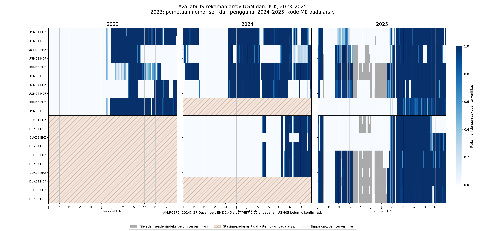

# Availability rekaman Merapi 2023–2025

Audit 28 Oktober 2026. Hasil dari arsip lokal yang tersedia; bukan inventaris seluruh rekaman yang mungkin dimiliki operator.

## Inventaris

| Tahun | Jaringan | Stasiun | Stream | File | GB logis | Tanggal file |
|---|---|---:|---:|---:|---:|---|
| 2023 | AM | 10 | 20 | 3,987 | 62.488 | 2023-01-01–2023-12-31 |
| 2024 | AM | 1 | 2 | 2 | 0.000 | 2024-12-27–2024-12-27 |
| 2024 | ME | 12 | 27 | 2,980 | 47.415 | 2024-01-01–2024-12-30 |
| 2025 | AM | 12 | 28 | 6,910 | 105.793 | 2025-01-01–2025-12-31 |
| 2025 | GE | 21 | 803 | 109,674 | 106.079 | 2025-01-01–2025-07-27 |
| 2025 | GF | 1 | 3 | 3 | 0.004 | 2025-07-27–2025-07-27 |
| 2025 | ME | 13 | 30 | 6,183 | 162.905 | 2025-01-01–2025-12-31 |

Ukuran logis dapat mencakup prealokasi, terutama arsip CAPS 2025. Jumlah stasiun adalah entri per jaringan; perangkat fisik dapat muncul memakai kode berbeda.

## Irisan array

| Tahun | Array | Stasiun | Kanal | Durasi ekuivalen hari | % tahun | Tanggal berisi irisan | Hari UTC utuh |
|---|---|---:|---|---:|---:|---:|---:|
| 2023 | UGM | 5 | EHZ | 27.0355 | 7.407 | 29 | 7 |
| 2023 | UGM | 5 | HDF | 27.0351 | 7.407 | 29 | 7 |
| 2023 | UGM | 5 | 10channels | 27.0346 | 7.407 | 29 | 7 |
| 2024 | UGM | 4 | EHZ | 99.8499 | 27.281 | 108 | 0 |
| 2024 | UGM | 4 | HDF | 99.8611 | 27.284 | 108 | 0 |
| 2024 | UGM | 4 | 8channels | 99.8440 | 27.280 | 108 | 0 |
| 2024 | DUK | 3 | EHZ | 50.0732 | 13.681 | 56 | 0 |
| 2024 | DUK | 3 | HDF | 80.5330 | 22.004 | 90 | 3 |
| 2024 | DUK | 3 | 6channels | 50.0714 | 13.681 | 56 | 0 |
| 2024 | DUK | 4 | EHZ | 49.3895 | 13.494 | 54 | 0 |
| 2025 | UGM | 5 | EHZ | 95.9961 | 26.300 | 114 | 0 |
| 2025 | UGM | 5 | HDF | 95.9928 | 26.299 | 114 | 0 |
| 2025 | UGM | 5 | 10channels | 95.9785 | 26.295 | 114 | 0 |
| 2025 | DUK | 5 | EHZ | 119.0508 | 32.617 | 127 | 0 |
| 2025 | DUK | 5 | HDF | 119.0509 | 32.617 | 127 | 0 |
| 2025 | DUK | 5 | 10channels | 119.0484 | 32.616 | 127 | 0 |

Durasi ekuivalen hari = jumlah detik semua interval / 86.400. Persentase dihitung terhadap seluruh tahun: 365 hari (2023/2025), 366 hari (2024). Angka empat stasiun tidak dapat dibandingkan langsung dengan lima stasiun sebagai indikator uptime array yang sama.

## Pemetaan dan kelengkapan stasiun

- Tahun 2023, UGM01–UGM05 menggunakan pemetaan pengguna: RE5DE, R6940, R265F, R7D17, R0279 pada jaringan AM.
- Tahun 2024/2025, label ME.UGMxx dan ME.DUKxx mengikuti kode arsip. Identitas nomor seri dan lokasi perangkat lintas tahun belum diaudit.
- Arsip 2023 tidak memuat stasiun berkode DUK. Lima stasiun AM lain adalah lokasi Merapi menurut pemetaan pengguna; tidak diasumsikan sebagai DUK.
- Arsip 2024 memuat ME.UGM01–04 dan ME.DUK01–04. ME.UGM05 serta ME.DUK05 tidak ditemukan. HDF DUK04 juga tidak ditemukan; DUK dapat dinilai sebagai empat EHZ atau tiga pasangan EHZ+HDF.
- AM.R0279 tahun 2024 ditampilkan terpisah: belum dikonfirmasi sebagai UGM05. Rekaman hanya sekitar 2,45 detik EHZ dan 2,09 detik HDF pada 27 Desember, sedangkan UGM01 berakhir 23 Desember; bahkan dengan pemetaan tersebut tidak ada tanggal file bersama kelima stasiun.

## Metode dan batas interpretasi

- Sumber 2023: `/Volumes/Untitled 2/2023/2023`; 2024: `/Volumes/Untitled 2/2024`; 2025: `/Volumes/My Passport/2025`.
- Tahun 2023/2024 dibaca ulang memakai ObsPy MiniSEED headonly. Interval trace adalah `[starttime, endtime + delta)`; hasil dipotong ke tahun UTC terkait.
- Tahun 2025 memakai hasil audit sebelumnya: ME dari indeks CAPS RAW yang divalidasi terhadap header pada 30 file; AM hanya metadata rentang file; GE hanya inventaris nama file; GF hanya metadata.
- Interval trace/indeks digabung tanpa interpolasi, dengan toleransi pembulatan 1 mikrodetik. Hari UTC utuh berarti cakupan minimal 86399,99 detik. Detail kontinuitas di dalam trace mengikuti pembentukan trace oleh pembaca MiniSEED.
- File dengan header/indeks tidak terbaca tidak dimasukkan sebagai cakupan terverifikasi. Itu tidak membuktikan bahwa seluruh payload rusak atau tidak dapat dipulihkan.
- Pembaca MiniSEED dapat melewati bagian file yang bukan record valid. Jika trace tetap terbaca, hanya interval trace tersebut dihitung; peringatan yang tertangkap dicatat dalam tabel masalah file.
- Belum dilakukan penilaian noise, clipping, kalibrasi, mutu event, maupun CRC/payload seluruh arsip.
- MiniSEED SDS menggunakan nomor hari mulai 1; nama file CAPS mulai 0. Tahun kabisat 2024 ditangani dengan 366 hari.
- Biru pada plot array menunjukkan fraksi hari dengan cakupan terverifikasi; abu-abu menunjukkan file belum terverifikasi; arsiran menunjukkan stasiun/padanan tidak ditemukan.
- Plot seluruh stasiun memakai oranye untuk keberadaan file AM 2025 karena gap di dalam file jaringan itu belum diperiksa.

## Berkas hasil

- [Perbandingan array](array-comparison-2023-2025.csv)
- [File kosong dan masalah pembacaan 2023/2024](files-with-issues-2023-2024.csv)
- [Inventaris jaringan](network-inventory-2023-2025.csv)
- [Availability semua stream](stream-availability-2023-2025.csv)
- [Cakupan harian dari header/indeks](daily-coverage-2023-2025.csv)
- [Plot EHZ semua stasiun AM/ME](all-stations-ehz-2023-2025.png)
- [Plot HDF semua stasiun AM/ME](all-stations-hdf-2023-2025.png)
- Berkas `YYYY-array-Nstations-kanal-windows.csv` berisi interval bersama dalam UTC, dengan waktu akhir eksklusif.

## Interval terpanjang untuk EHZ

| Tahun | Array | Jumlah stasiun | Awal UTC | Akhir UTC (eksklusif) | Jam |
|---|---|---:|---|---|---:|
| 2023 | UGM | 5 | 2023-08-19T11:47:04.824999+00:00 | 2023-08-22T22:00:38.031000+00:00 | 82.2259 |
| 2024 | UGM | 4 | 2024-06-01T00:01:02.758900+00:00 | 2024-06-01T12:00:59.687900+00:00 | 11.9991 |
| 2024 | DUK | 3 | 2024-10-11T00:01:05.122000+00:00 | 2024-10-12T00:00:00.982000+00:00 | 23.9822 |
| 2024 | DUK | 4 | 2024-10-10T04:34:47.872000+00:00 | 2024-10-11T00:00:01.390900+00:00 | 19.4204 |
| 2025 | UGM | 5 | 2025-12-21T00:14:19.783000+00:00 | 2025-12-21T12:00:59.303000+00:00 | 11.7776 |
| 2025 | DUK | 5 | 2025-07-31T12:01:03.609999+00:00 | 2025-08-01T00:01:00.230000+00:00 | 11.9991 |
