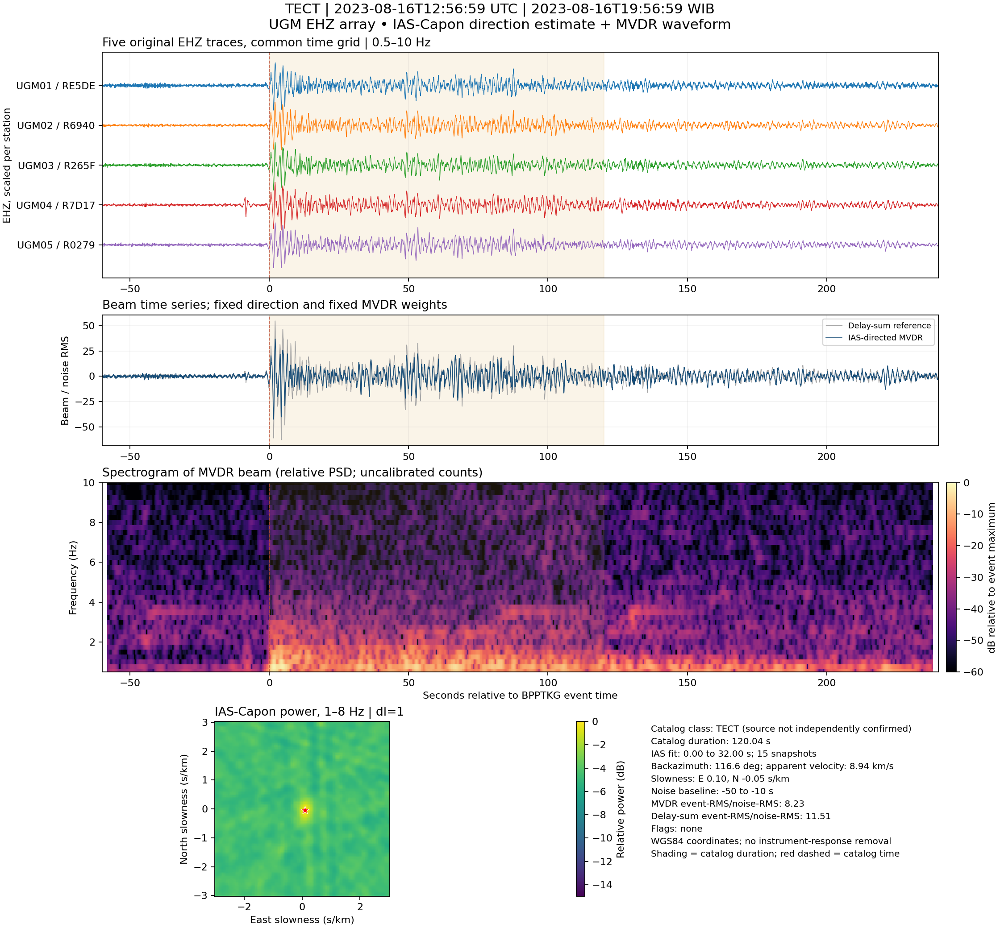
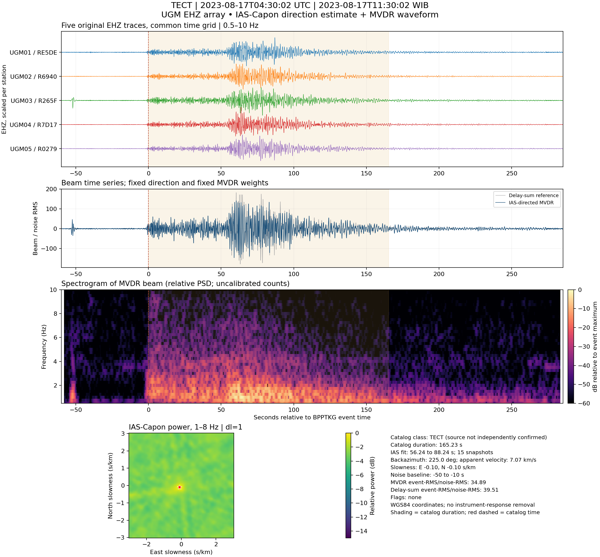
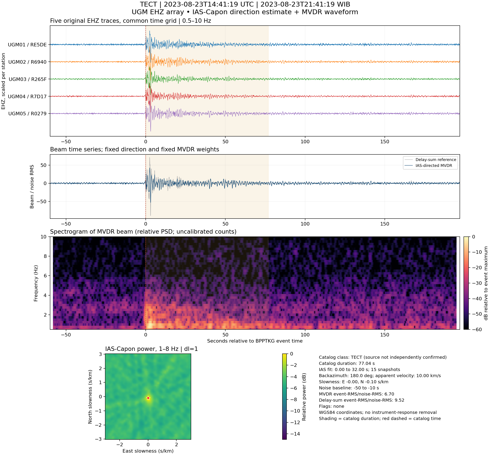
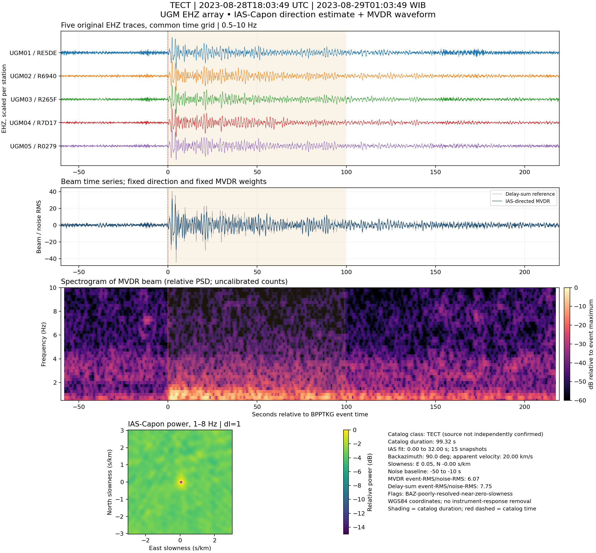
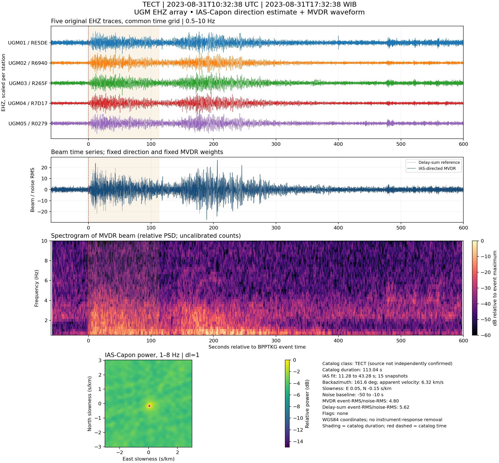
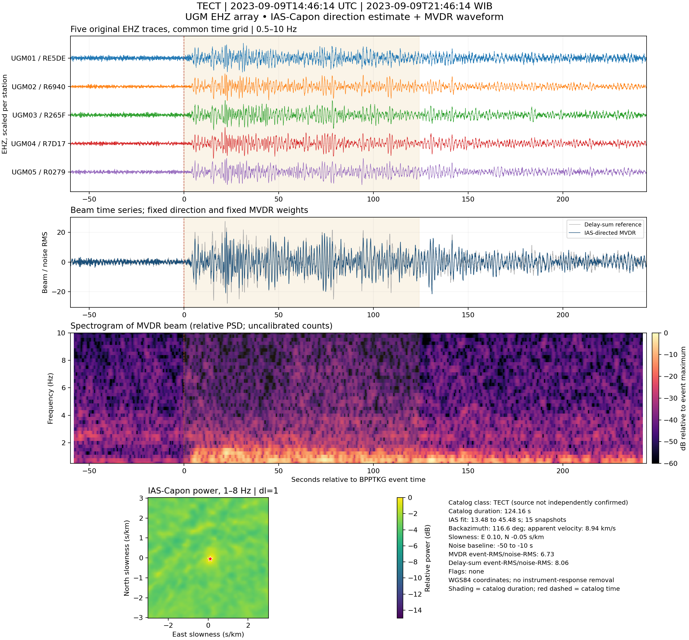
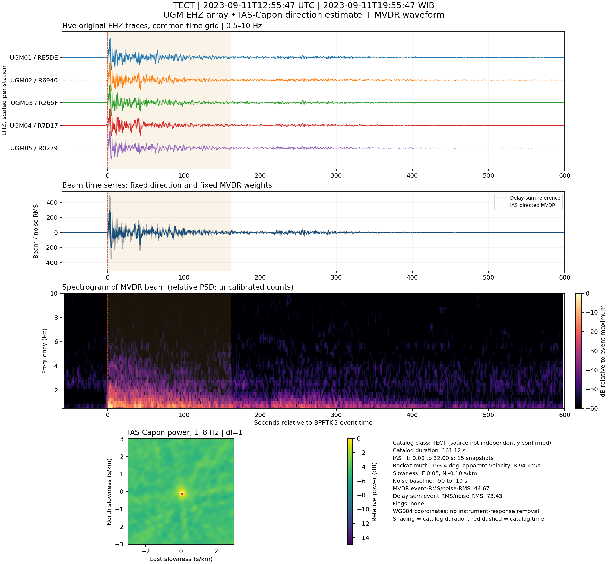
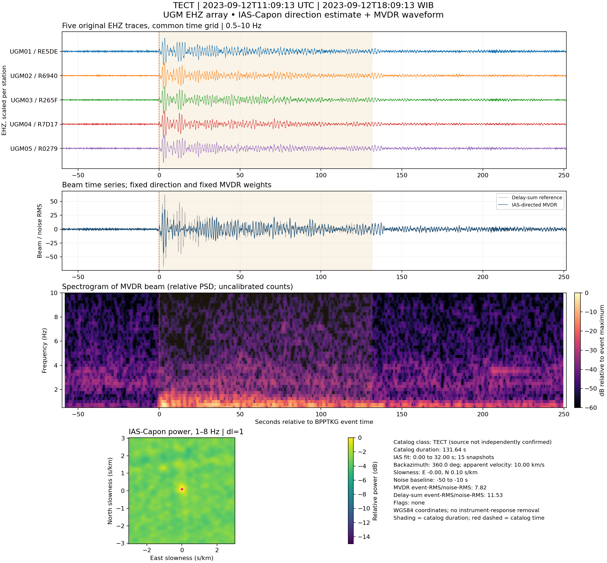

# Galeri seluruh kandidat TECT

Kelas adalah label katalog BPPTKG; sumber belum divalidasi secara independen. Waktu tabel/ID adalah UTC.

[Kembali ke ringkasan](README.md)

## 20230816T125659_TECT_row51619

Status: **kandidat utama**. PASS operational beam selection.

BAZ 116.6°, kecepatan semu 8.94 km/s, beam RMS SNR 8.23.

[PNG penuh](figures/20230816T125659_TECT_row51619.png) · [EHZ asli 100 Hz](waveforms/20230816T125659_TECT_row51619_EHZ_RAW.mseed) · [EHZ proses 25 Hz](waveforms/20230816T125659_TECT_row51619_EHZ_25Hz.mseed) · [Beam MVDR dan delay-sum](beam_products/20230816T125659_TECT_row51619_BEAMS.mseed) · [Metadata](metadata/20230816T125659_TECT_row51619.json)

## 20230817T043002_TECT_row51492

Status: **kandidat utama**. PASS operational beam selection.

BAZ 225.0°, kecepatan semu 7.07 km/s, beam RMS SNR 34.89.

[PNG penuh](figures/20230817T043002_TECT_row51492.png) · [EHZ asli 100 Hz](waveforms/20230817T043002_TECT_row51492_EHZ_RAW.mseed) · [EHZ proses 25 Hz](waveforms/20230817T043002_TECT_row51492_EHZ_25Hz.mseed) · [Beam MVDR dan delay-sum](beam_products/20230817T043002_TECT_row51492_BEAMS.mseed) · [Metadata](metadata/20230817T043002_TECT_row51492.json)

## 20230823T144119_TECT_row49865

Status: **kandidat utama**. PASS operational beam selection.

BAZ 180.0°, kecepatan semu 10.00 km/s, beam RMS SNR 6.70.

[PNG penuh](figures/20230823T144119_TECT_row49865.png) · [EHZ asli 100 Hz](waveforms/20230823T144119_TECT_row49865_EHZ_RAW.mseed) · [EHZ proses 25 Hz](waveforms/20230823T144119_TECT_row49865_EHZ_25Hz.mseed) · [Beam MVDR dan delay-sum](beam_products/20230823T144119_TECT_row49865_BEAMS.mseed) · [Metadata](metadata/20230823T144119_TECT_row49865.json)

## 20230828T180349_TECT_row48078

Status: **kandidat utama**. PASS operational beam selection.

BAZ 90.0°, kecepatan semu 20.00 km/s, beam RMS SNR 6.07.

[PNG penuh](figures/20230828T180349_TECT_row48078.png) · [EHZ asli 100 Hz](waveforms/20230828T180349_TECT_row48078_EHZ_RAW.mseed) · [EHZ proses 25 Hz](waveforms/20230828T180349_TECT_row48078_EHZ_25Hz.mseed) · [Beam MVDR dan delay-sum](beam_products/20230828T180349_TECT_row48078_BEAMS.mseed) · [Metadata](metadata/20230828T180349_TECT_row48078.json)

## 20230831T103238_TECT_row47224

Status: **kandidat utama**. PASS operational beam selection.

BAZ 161.6°, kecepatan semu 6.32 km/s, beam RMS SNR 4.80.

[PNG penuh](figures/20230831T103238_TECT_row47224.png) · [EHZ asli 100 Hz](waveforms/20230831T103238_TECT_row47224_EHZ_RAW.mseed) · [EHZ proses 25 Hz](waveforms/20230831T103238_TECT_row47224_EHZ_25Hz.mseed) · [Beam MVDR dan delay-sum](beam_products/20230831T103238_TECT_row47224_BEAMS.mseed) · [Metadata](metadata/20230831T103238_TECT_row47224.json)

## 20230909T144614_TECT_row42926

Status: **kandidat utama**. PASS operational beam selection.

BAZ 116.6°, kecepatan semu 8.94 km/s, beam RMS SNR 6.73.

[PNG penuh](figures/20230909T144614_TECT_row42926.png) · [EHZ asli 100 Hz](waveforms/20230909T144614_TECT_row42926_EHZ_RAW.mseed) · [EHZ proses 25 Hz](waveforms/20230909T144614_TECT_row42926_EHZ_25Hz.mseed) · [Beam MVDR dan delay-sum](beam_products/20230909T144614_TECT_row42926_BEAMS.mseed) · [Metadata](metadata/20230909T144614_TECT_row42926.json)

## 20230911T125547_TECT_row42191

Status: **kandidat utama**. PASS operational beam selection.

BAZ 153.4°, kecepatan semu 8.94 km/s, beam RMS SNR 44.67.

[PNG penuh](figures/20230911T125547_TECT_row42191.png) · [EHZ asli 100 Hz](waveforms/20230911T125547_TECT_row42191_EHZ_RAW.mseed) · [EHZ proses 25 Hz](waveforms/20230911T125547_TECT_row42191_EHZ_25Hz.mseed) · [Beam MVDR dan delay-sum](beam_products/20230911T125547_TECT_row42191_BEAMS.mseed) · [Metadata](metadata/20230911T125547_TECT_row42191.json)

## 20230912T110913_TECT_row41962

Status: **kandidat utama**. PASS operational beam selection.

BAZ 360.0°, kecepatan semu 10.00 km/s, beam RMS SNR 7.82.

[PNG penuh](figures/20230912T110913_TECT_row41962.png) · [EHZ asli 100 Hz](waveforms/20230912T110913_TECT_row41962_EHZ_RAW.mseed) · [EHZ proses 25 Hz](waveforms/20230912T110913_TECT_row41962_EHZ_25Hz.mseed) · [Beam MVDR dan delay-sum](beam_products/20230912T110913_TECT_row41962_BEAMS.mseed) · [Metadata](metadata/20230912T110913_TECT_row41962.json)

