# Galeri kandidat yang memerlukan review

Kelas adalah label katalog BPPTKG; sumber belum divalidasi secara independen. Waktu tabel/ID adalah UTC.

[Kembali ke ringkasan](README.md)

## 20230820T183756_ROCKFALL_row50775

Status: **perlu review**. MVDR event-RMS/noise-RMS <3; diagonal-loading-sensitive; weak-MVDR-event-RMS; volcanic-class BAZ outside 350–10 deg.

BAZ 149.0°, kecepatan semu 3.43 km/s, beam RMS SNR 1.07.

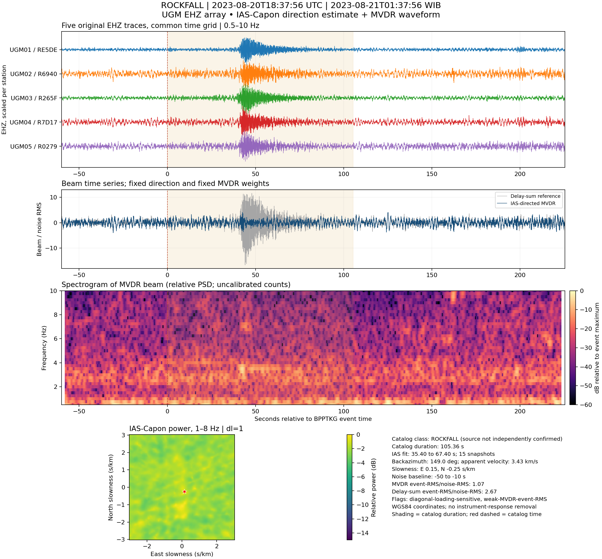

[PNG penuh](figures/20230820T183756_ROCKFALL_row50775.png) · [EHZ asli 100 Hz](waveforms/20230820T183756_ROCKFALL_row50775_EHZ_RAW.mseed) · [EHZ proses 25 Hz](waveforms/20230820T183756_ROCKFALL_row50775_EHZ_25Hz.mseed) · [Beam MVDR dan delay-sum](beam_products/20230820T183756_ROCKFALL_row50775_BEAMS.mseed) · [Metadata](metadata/20230820T183756_ROCKFALL_row50775.json)

## 20230821T232000_VTB_row50504

Status: **perlu review**. diagonal-loading-sensitive.

BAZ 350.5°, kecepatan semu 1.10 km/s, beam RMS SNR 9.14.

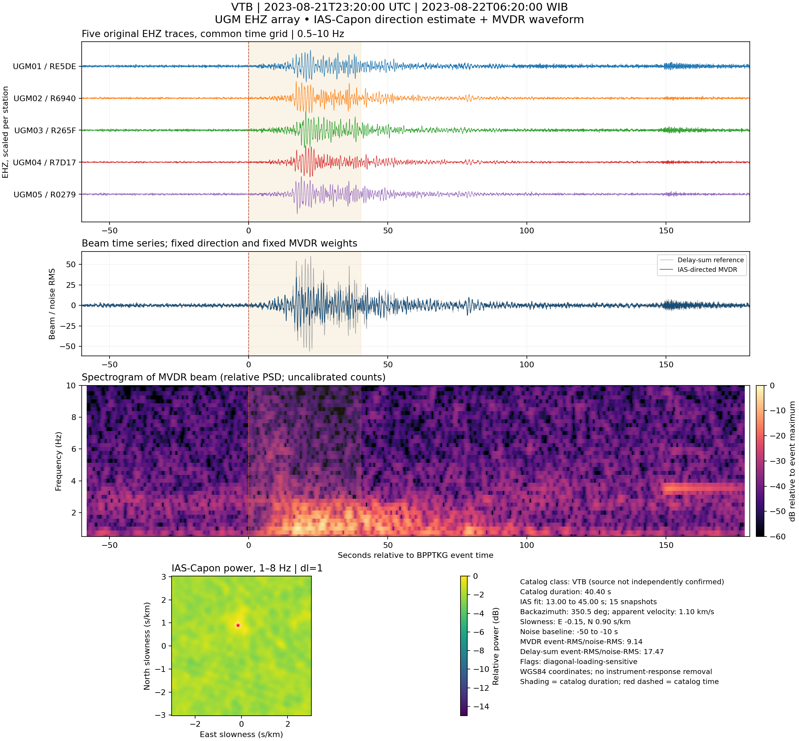

[PNG penuh](figures/20230821T232000_VTB_row50504.png) · [EHZ asli 100 Hz](waveforms/20230821T232000_VTB_row50504_EHZ_RAW.mseed) · [EHZ proses 25 Hz](waveforms/20230821T232000_VTB_row50504_EHZ_25Hz.mseed) · [Beam MVDR dan delay-sum](beam_products/20230821T232000_VTB_row50504_BEAMS.mseed) · [Metadata](metadata/20230821T232000_VTB_row50504.json)

## 20230822T203215_ROCKFALL_row50220

Status: **perlu review**. MVDR event-RMS/noise-RMS <3; diagonal-loading-sensitive; weak-MVDR-event-RMS; volcanic-class BAZ outside 350–10 deg.

BAZ 60.0°, kecepatan semu 0.67 km/s, beam RMS SNR 0.98.

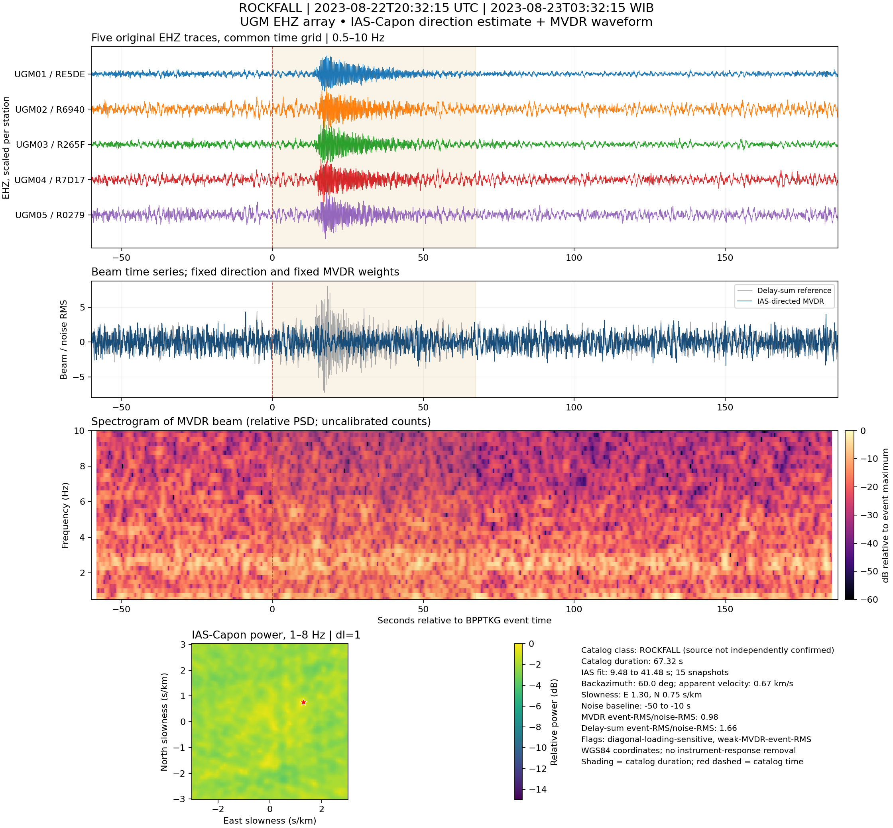

[PNG penuh](figures/20230822T203215_ROCKFALL_row50220.png) · [EHZ asli 100 Hz](waveforms/20230822T203215_ROCKFALL_row50220_EHZ_RAW.mseed) · [EHZ proses 25 Hz](waveforms/20230822T203215_ROCKFALL_row50220_EHZ_25Hz.mseed) · [Beam MVDR dan delay-sum](beam_products/20230822T203215_ROCKFALL_row50220_BEAMS.mseed) · [Metadata](metadata/20230822T203215_ROCKFALL_row50220.json)

## 20230823T224004_VTB_row49741

Status: **perlu review**. MVDR event-RMS/noise-RMS <3.

BAZ 354.3°, kecepatan semu 1.00 km/s, beam RMS SNR 2.88.

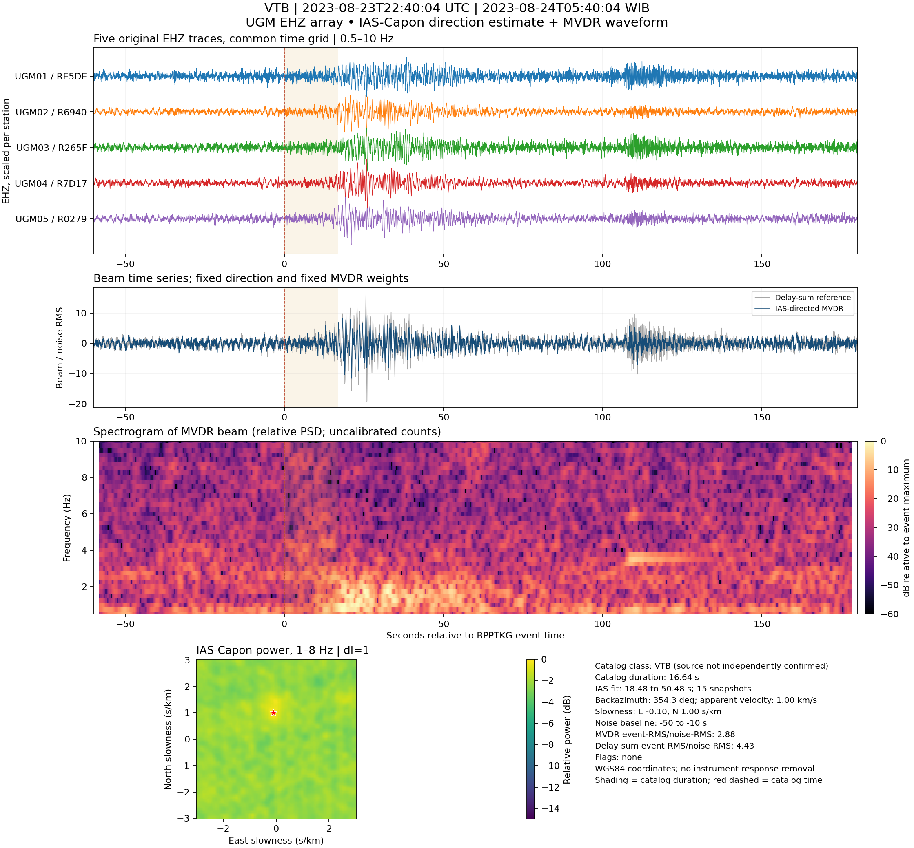

[PNG penuh](figures/20230823T224004_VTB_row49741.png) · [EHZ asli 100 Hz](waveforms/20230823T224004_VTB_row49741_EHZ_RAW.mseed) · [EHZ proses 25 Hz](waveforms/20230823T224004_VTB_row49741_EHZ_25Hz.mseed) · [Beam MVDR dan delay-sum](beam_products/20230823T224004_VTB_row49741_BEAMS.mseed) · [Metadata](metadata/20230823T224004_VTB_row49741.json)

## 20230824T200521_ROCKFALL_row49394

Status: **perlu review**. MVDR event-RMS/noise-RMS <3; diagonal-loading-sensitive; weak-MVDR-event-RMS; volcanic-class BAZ outside 350–10 deg.

BAZ 180.0°, kecepatan semu 0.61 km/s, beam RMS SNR 0.85.

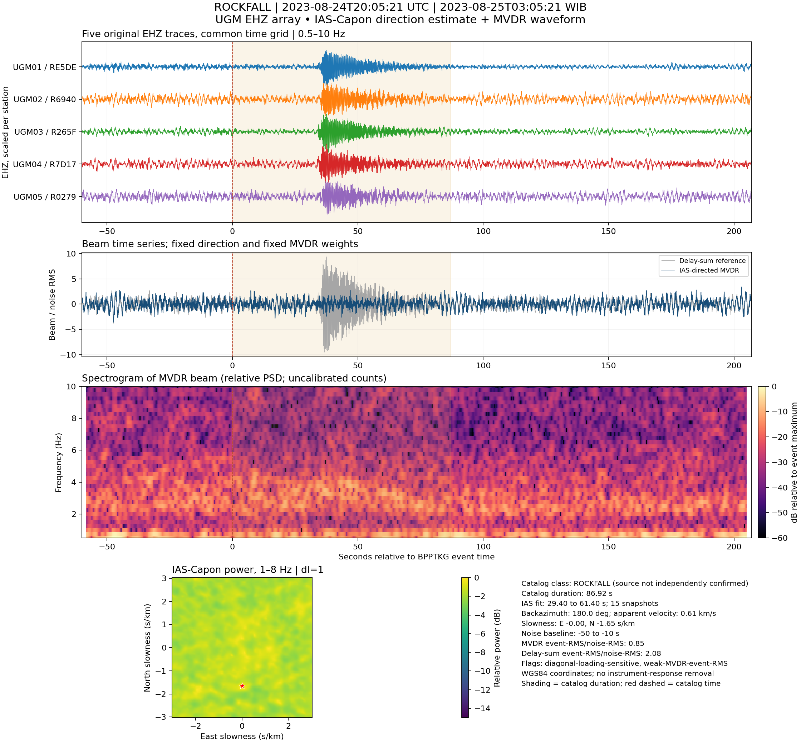

[PNG penuh](figures/20230824T200521_ROCKFALL_row49394.png) · [EHZ asli 100 Hz](waveforms/20230824T200521_ROCKFALL_row49394_EHZ_RAW.mseed) · [EHZ proses 25 Hz](waveforms/20230824T200521_ROCKFALL_row49394_EHZ_25Hz.mseed) · [Beam MVDR dan delay-sum](beam_products/20230824T200521_ROCKFALL_row49394_BEAMS.mseed) · [Metadata](metadata/20230824T200521_ROCKFALL_row49394.json)

## 20230825T195231_ROCKFALL_row49060

Status: **perlu review**. MVDR event-RMS/noise-RMS <3; diagonal-loading-sensitive; weak-MVDR-event-RMS; volcanic-class BAZ outside 350–10 deg.

BAZ 344.6°, kecepatan semu 0.66 km/s, beam RMS SNR 1.16.

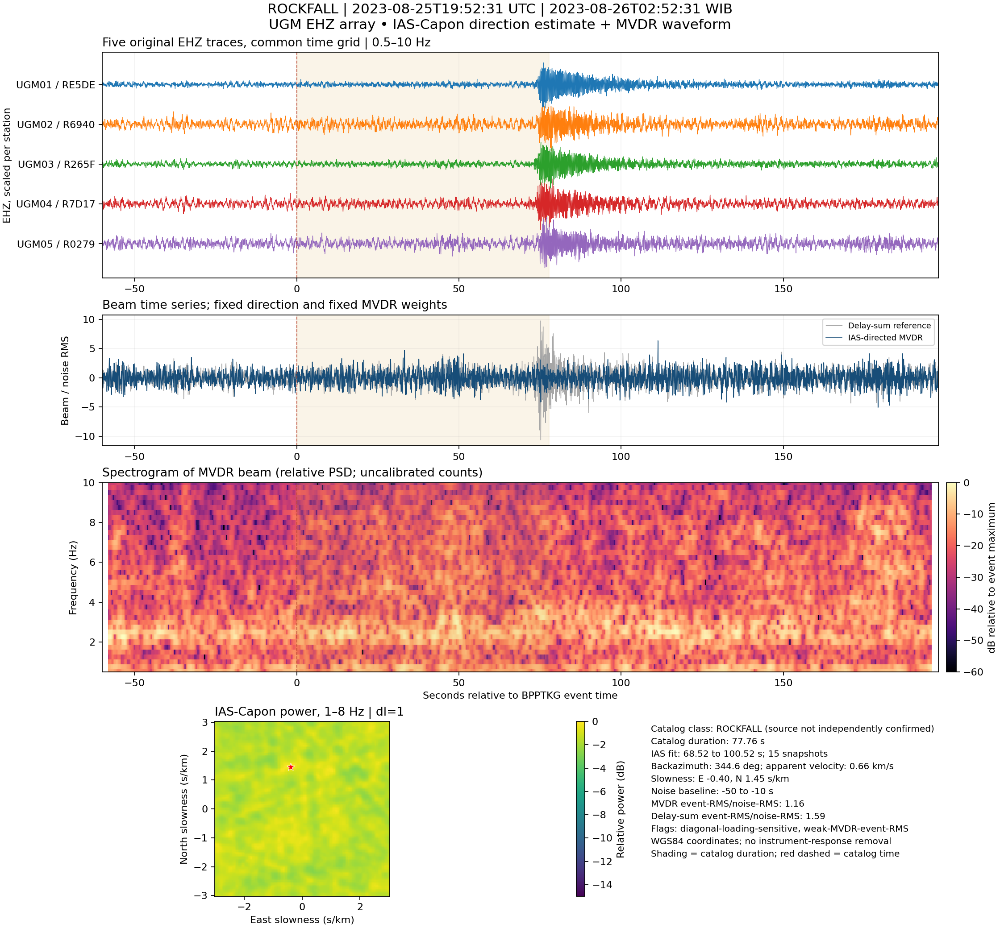

[PNG penuh](figures/20230825T195231_ROCKFALL_row49060.png) · [EHZ asli 100 Hz](waveforms/20230825T195231_ROCKFALL_row49060_EHZ_RAW.mseed) · [EHZ proses 25 Hz](waveforms/20230825T195231_ROCKFALL_row49060_EHZ_25Hz.mseed) · [Beam MVDR dan delay-sum](beam_products/20230825T195231_ROCKFALL_row49060_BEAMS.mseed) · [Metadata](metadata/20230825T195231_ROCKFALL_row49060.json)

## 20230825T152408_VTB_row49130

Status: **perlu review**. diagonal-loading-sensitive; volcanic-class BAZ outside 350–10 deg.

BAZ 18.4°, kecepatan semu 6.32 km/s, beam RMS SNR 4.50.

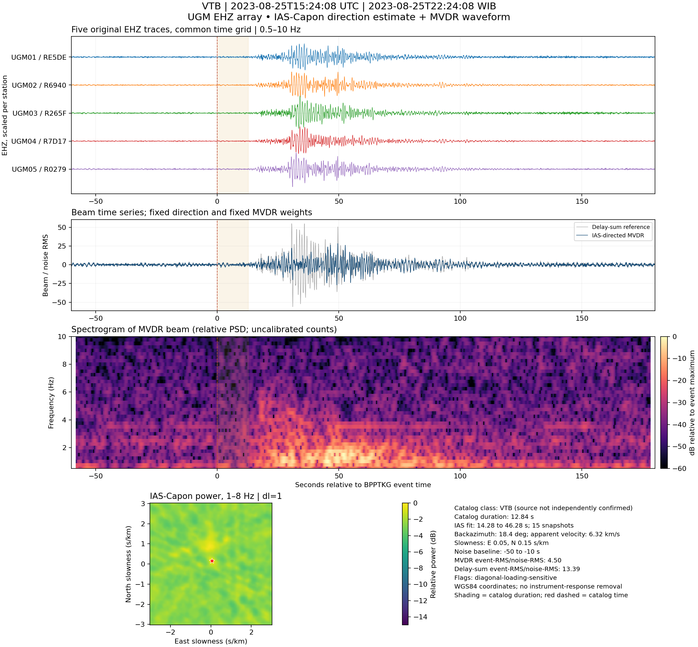

[PNG penuh](figures/20230825T152408_VTB_row49130.png) · [EHZ asli 100 Hz](waveforms/20230825T152408_VTB_row49130_EHZ_RAW.mseed) · [EHZ proses 25 Hz](waveforms/20230825T152408_VTB_row49130_EHZ_25Hz.mseed) · [Beam MVDR dan delay-sum](beam_products/20230825T152408_VTB_row49130_BEAMS.mseed) · [Metadata](metadata/20230825T152408_VTB_row49130.json)

## 20230826T204713_MP_row48673

Status: **perlu review**. MVDR event-RMS/noise-RMS <3; diagonal-loading-sensitive; weak-MVDR-event-RMS; volcanic-class BAZ outside 350–10 deg.

BAZ 141.3°, kecepatan semu 3.12 km/s, beam RMS SNR 1.05.

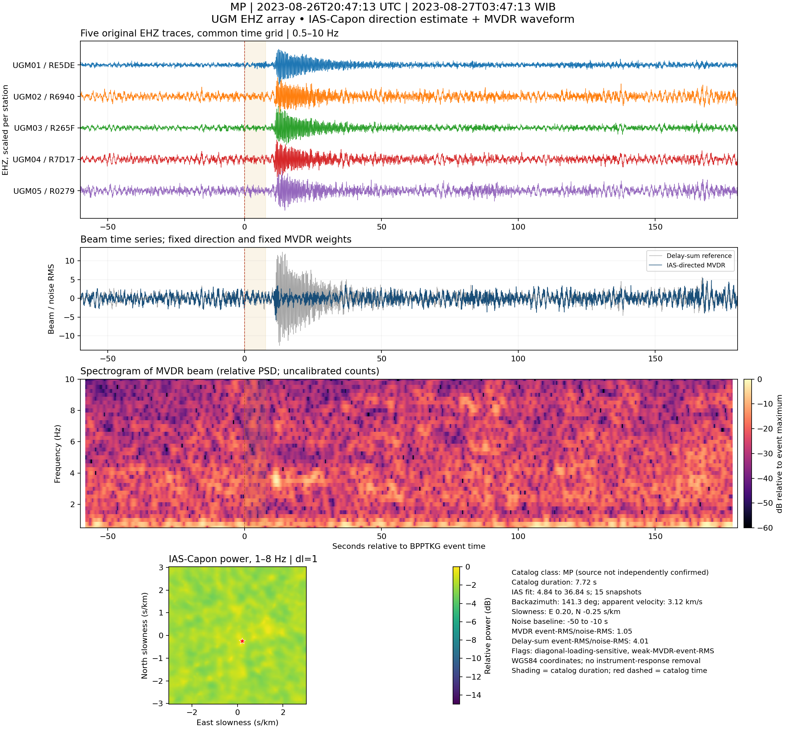

[PNG penuh](figures/20230826T204713_MP_row48673.png) · [EHZ asli 100 Hz](waveforms/20230826T204713_MP_row48673_EHZ_RAW.mseed) · [EHZ proses 25 Hz](waveforms/20230826T204713_MP_row48673_EHZ_25Hz.mseed) · [Beam MVDR dan delay-sum](beam_products/20230826T204713_MP_row48673_BEAMS.mseed) · [Metadata](metadata/20230826T204713_MP_row48673.json)

## 20230828T211942_ROCKFALL_row48050

Status: **perlu review**. MVDR event-RMS/noise-RMS <3; diagonal-loading-sensitive; weak-MVDR-event-RMS; volcanic-class BAZ outside 350–10 deg.

BAZ 347.9°, kecepatan semu 0.70 km/s, beam RMS SNR 0.98.

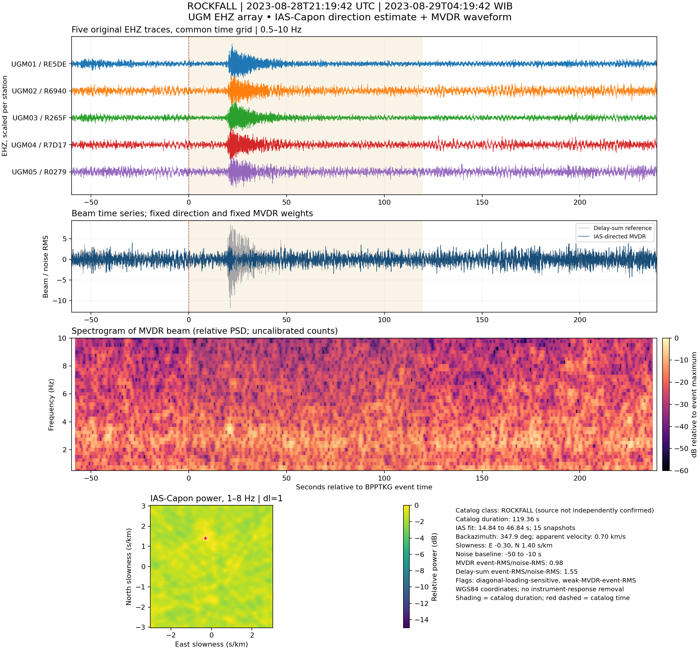

[PNG penuh](figures/20230828T211942_ROCKFALL_row48050.png) · [EHZ asli 100 Hz](waveforms/20230828T211942_ROCKFALL_row48050_EHZ_RAW.mseed) · [EHZ proses 25 Hz](waveforms/20230828T211942_ROCKFALL_row48050_EHZ_25Hz.mseed) · [Beam MVDR dan delay-sum](beam_products/20230828T211942_ROCKFALL_row48050_BEAMS.mseed) · [Metadata](metadata/20230828T211942_ROCKFALL_row48050.json)

## 20230828T112410_VTB_row48151

Status: **perlu review**. MVDR event-RMS/noise-RMS <3; weak-MVDR-event-RMS.

BAZ 358.0°, kecepatan semu 0.71 km/s, beam RMS SNR 0.95.

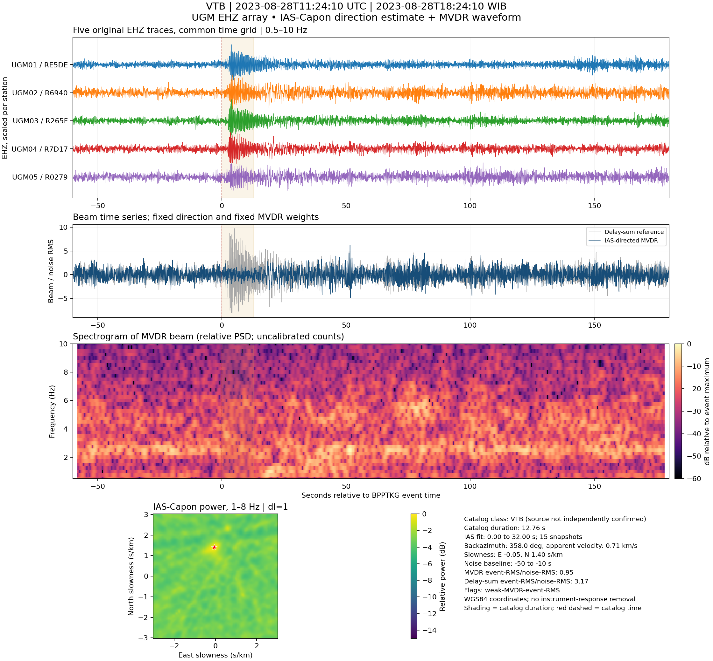

[PNG penuh](figures/20230828T112410_VTB_row48151.png) · [EHZ asli 100 Hz](waveforms/20230828T112410_VTB_row48151_EHZ_RAW.mseed) · [EHZ proses 25 Hz](waveforms/20230828T112410_VTB_row48151_EHZ_25Hz.mseed) · [Beam MVDR dan delay-sum](beam_products/20230828T112410_VTB_row48151_BEAMS.mseed) · [Metadata](metadata/20230828T112410_VTB_row48151.json)

## 20230828T001311_VTB_row48288

Status: **perlu review**. volcanic-class BAZ outside 350–10 deg.

BAZ 346.8°, kecepatan semu 1.15 km/s, beam RMS SNR 4.81.

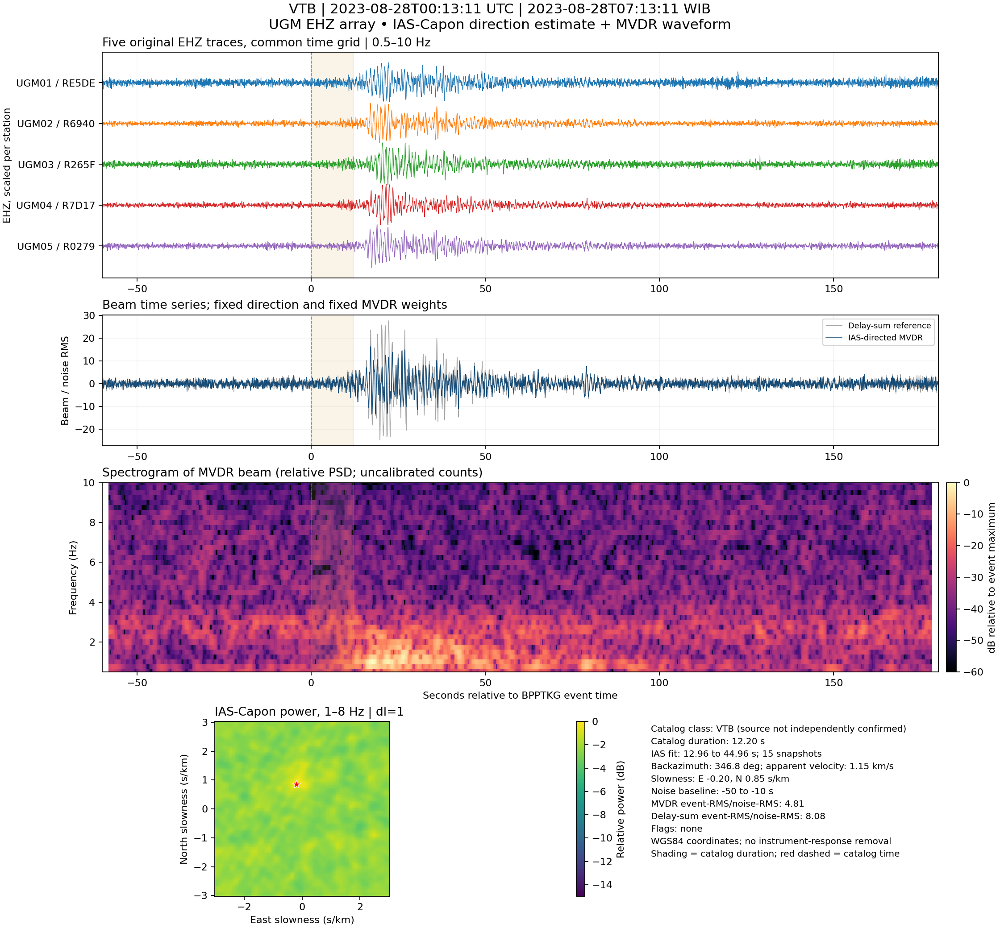

[PNG penuh](figures/20230828T001311_VTB_row48288.png) · [EHZ asli 100 Hz](waveforms/20230828T001311_VTB_row48288_EHZ_RAW.mseed) · [EHZ proses 25 Hz](waveforms/20230828T001311_VTB_row48288_EHZ_25Hz.mseed) · [Beam MVDR dan delay-sum](beam_products/20230828T001311_VTB_row48288_BEAMS.mseed) · [Metadata](metadata/20230828T001311_VTB_row48288.json)

## 20230829T184621_ROCKFALL_row47743

Status: **perlu review**. MVDR event-RMS/noise-RMS <3; diagonal-loading-sensitive; weak-MVDR-event-RMS; volcanic-class BAZ outside 350–10 deg.

BAZ 175.0°, kecepatan semu 0.59 km/s, beam RMS SNR 0.87.

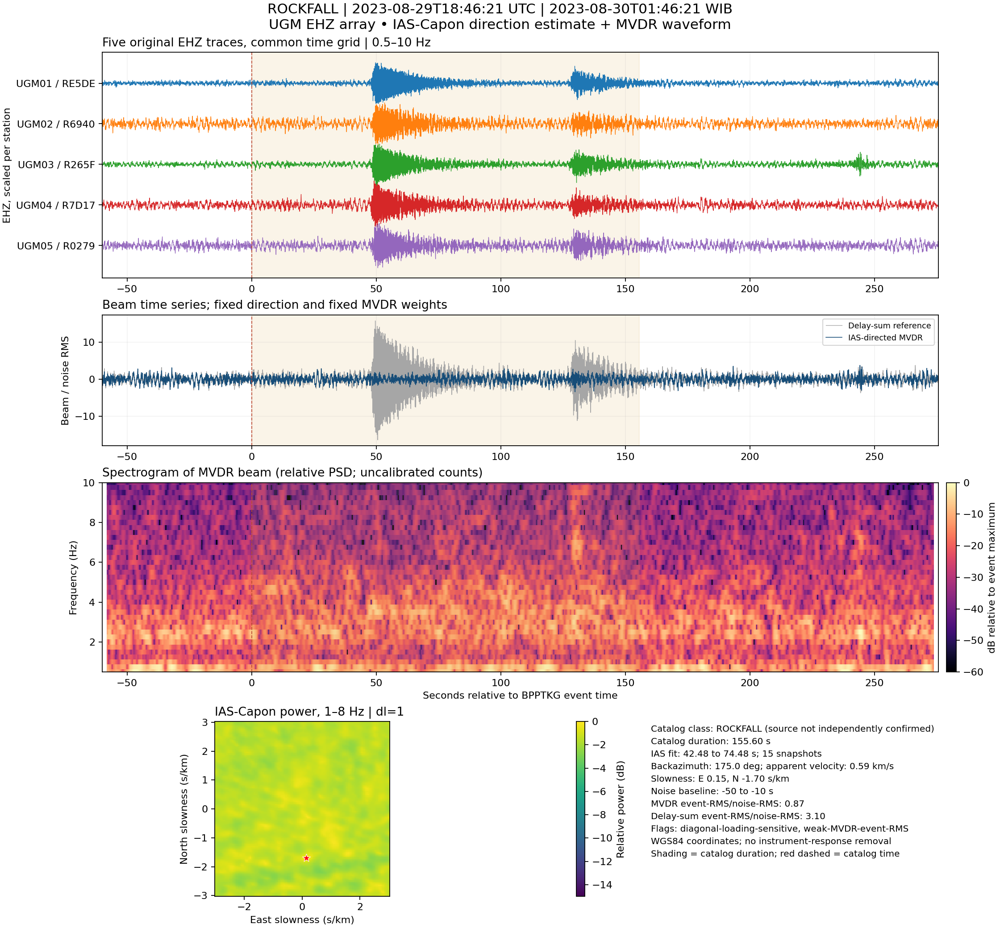

[PNG penuh](figures/20230829T184621_ROCKFALL_row47743.png) · [EHZ asli 100 Hz](waveforms/20230829T184621_ROCKFALL_row47743_EHZ_RAW.mseed) · [EHZ proses 25 Hz](waveforms/20230829T184621_ROCKFALL_row47743_EHZ_25Hz.mseed) · [Beam MVDR dan delay-sum](beam_products/20230829T184621_ROCKFALL_row47743_BEAMS.mseed) · [Metadata](metadata/20230829T184621_ROCKFALL_row47743.json)

## 20230829T120011_VTB_row47871

Status: **perlu review**. MVDR event-RMS/noise-RMS <3.

BAZ 351.9°, kecepatan semu 0.94 km/s, beam RMS SNR 2.78.

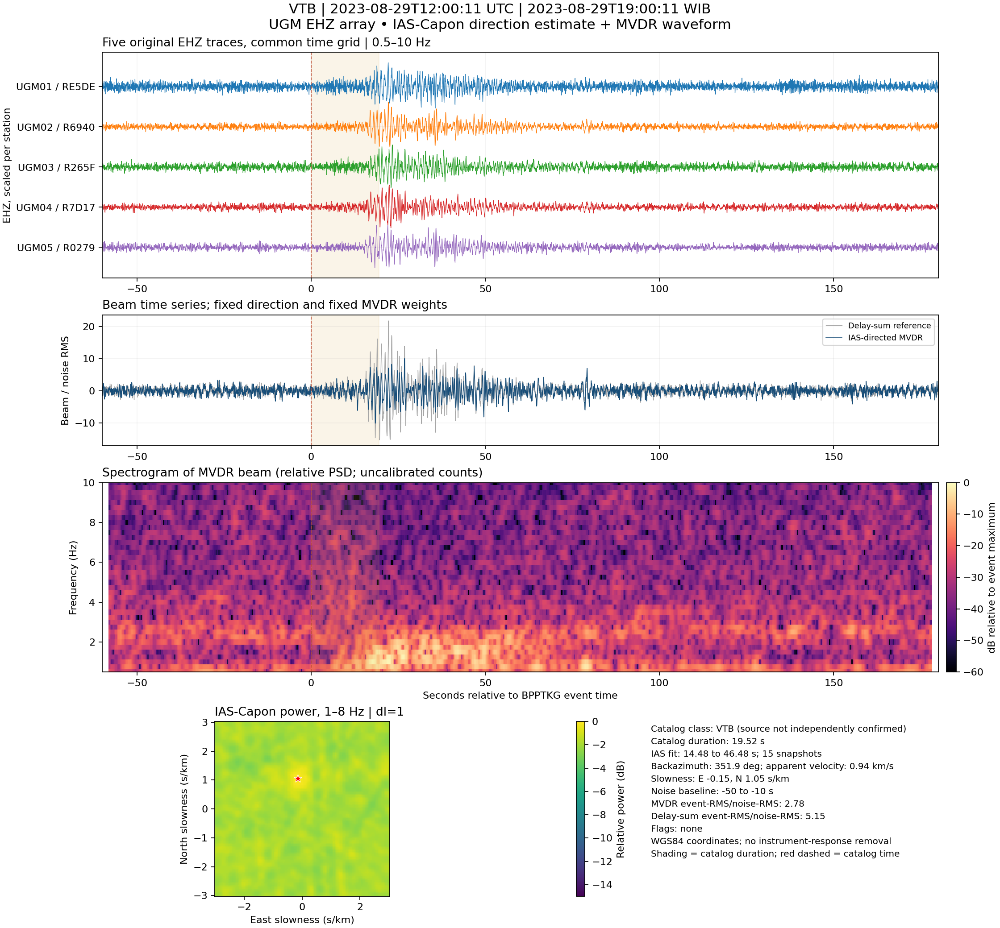

[PNG penuh](figures/20230829T120011_VTB_row47871.png) · [EHZ asli 100 Hz](waveforms/20230829T120011_VTB_row47871_EHZ_RAW.mseed) · [EHZ proses 25 Hz](waveforms/20230829T120011_VTB_row47871_EHZ_25Hz.mseed) · [Beam MVDR dan delay-sum](beam_products/20230829T120011_VTB_row47871_BEAMS.mseed) · [Metadata](metadata/20230829T120011_VTB_row47871.json)

## 20230901T200138_ROCKFALL_row46570

Status: **perlu review**. MVDR event-RMS/noise-RMS <3; weak-MVDR-event-RMS; volcanic-class BAZ outside 350–10 deg.

BAZ 180.0°, kecepatan semu 0.61 km/s, beam RMS SNR 0.87.

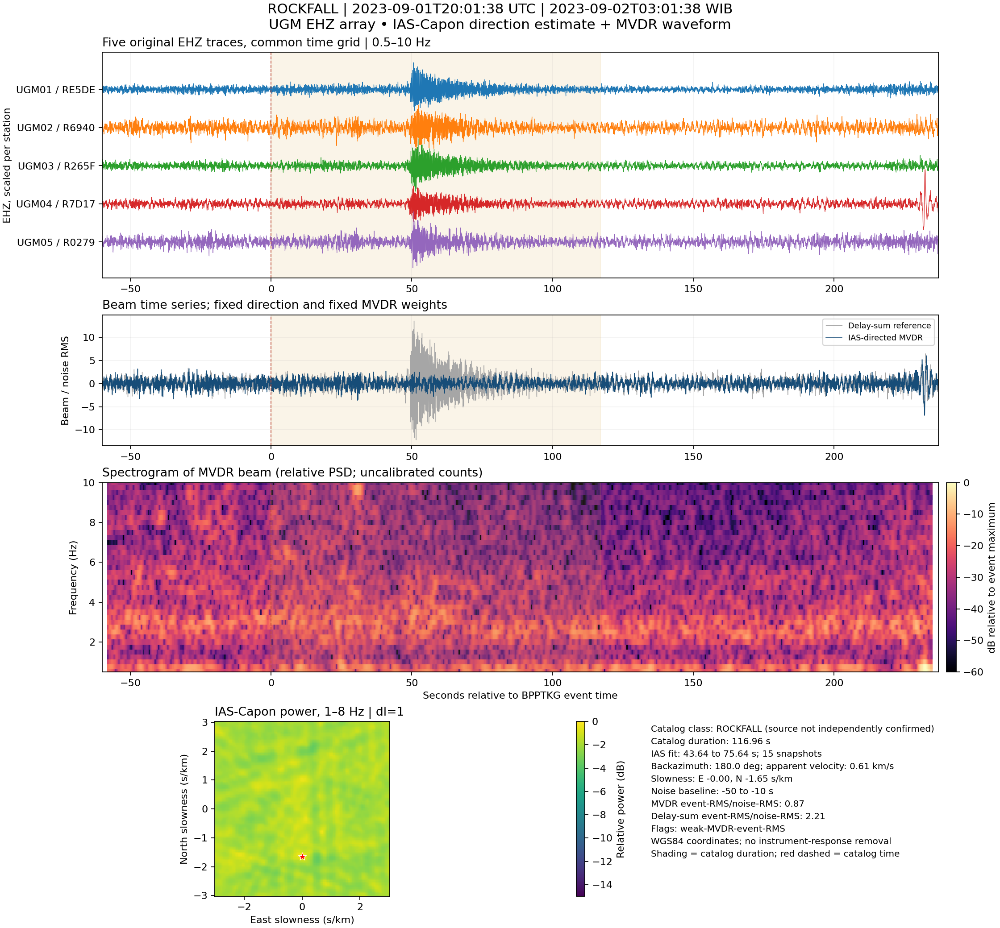

[PNG penuh](figures/20230901T200138_ROCKFALL_row46570.png) · [EHZ asli 100 Hz](waveforms/20230901T200138_ROCKFALL_row46570_EHZ_RAW.mseed) · [EHZ proses 25 Hz](waveforms/20230901T200138_ROCKFALL_row46570_EHZ_25Hz.mseed) · [Beam MVDR dan delay-sum](beam_products/20230901T200138_ROCKFALL_row46570_BEAMS.mseed) · [Metadata](metadata/20230901T200138_ROCKFALL_row46570.json)

## 20230901T165813_MP_row46651

Status: **perlu review**. MVDR event-RMS/noise-RMS <3; weak-MVDR-event-RMS; volcanic-class BAZ outside 350–10 deg.

BAZ 176.5°, kecepatan semu 0.60 km/s, beam RMS SNR 0.78.

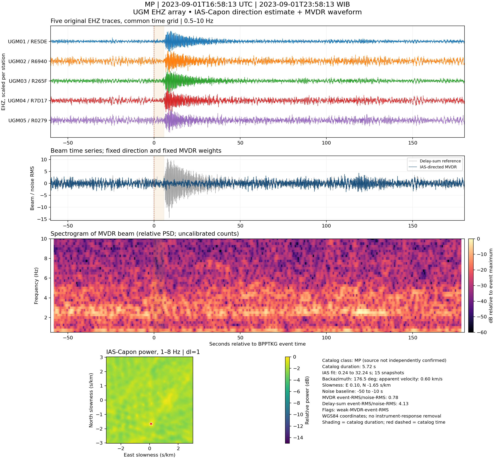

[PNG penuh](figures/20230901T165813_MP_row46651.png) · [EHZ asli 100 Hz](waveforms/20230901T165813_MP_row46651_EHZ_RAW.mseed) · [EHZ proses 25 Hz](waveforms/20230901T165813_MP_row46651_EHZ_25Hz.mseed) · [Beam MVDR dan delay-sum](beam_products/20230901T165813_MP_row46651_BEAMS.mseed) · [Metadata](metadata/20230901T165813_MP_row46651.json)

## 20230905T183334_MP_row44933

Status: **perlu review**. volcanic-class BAZ outside 350–10 deg.

BAZ 194.0°, kecepatan semu 4.85 km/s, beam RMS SNR 13.63.

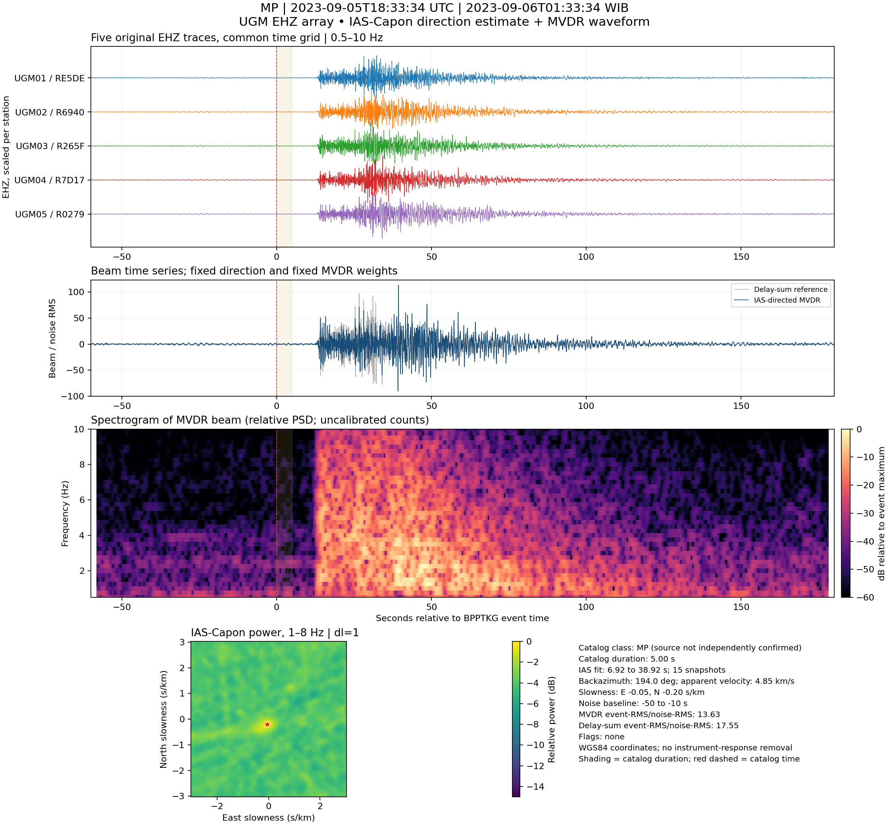

[PNG penuh](figures/20230905T183334_MP_row44933.png) · [EHZ asli 100 Hz](waveforms/20230905T183334_MP_row44933_EHZ_RAW.mseed) · [EHZ proses 25 Hz](waveforms/20230905T183334_MP_row44933_EHZ_25Hz.mseed) · [Beam MVDR dan delay-sum](beam_products/20230905T183334_MP_row44933_BEAMS.mseed) · [Metadata](metadata/20230905T183334_MP_row44933.json)

## 20230905T053716_VTB_row45168

Status: **perlu review**. MVDR event-RMS/noise-RMS <3; diagonal-loading-sensitive.

BAZ 360.0°, kecepatan semu 1.05 km/s, beam RMS SNR 2.54.

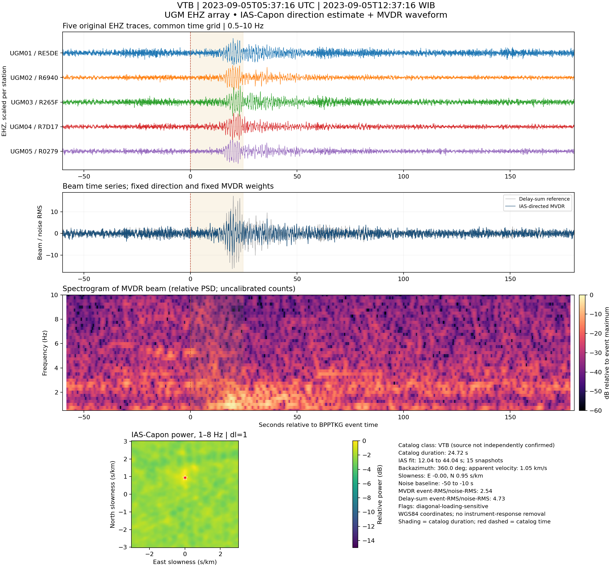

[PNG penuh](figures/20230905T053716_VTB_row45168.png) · [EHZ asli 100 Hz](waveforms/20230905T053716_VTB_row45168_EHZ_RAW.mseed) · [EHZ proses 25 Hz](waveforms/20230905T053716_VTB_row45168_EHZ_25Hz.mseed) · [Beam MVDR dan delay-sum](beam_products/20230905T053716_VTB_row45168_BEAMS.mseed) · [Metadata](metadata/20230905T053716_VTB_row45168.json)

## 20230907T192258_ROCKFALL_row43754

Status: **perlu review**. MVDR event-RMS/noise-RMS <3; weak-MVDR-event-RMS; volcanic-class BAZ outside 350–10 deg.

BAZ 135.0°, kecepatan semu 4.71 km/s, beam RMS SNR 1.69.

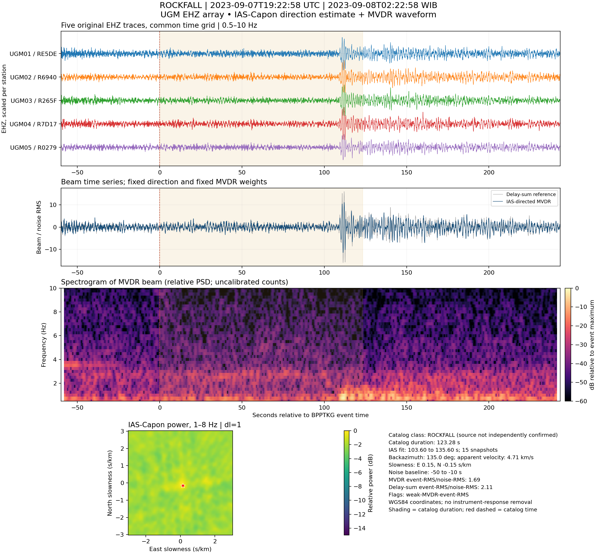

[PNG penuh](figures/20230907T192258_ROCKFALL_row43754.png) · [EHZ asli 100 Hz](waveforms/20230907T192258_ROCKFALL_row43754_EHZ_RAW.mseed) · [EHZ proses 25 Hz](waveforms/20230907T192258_ROCKFALL_row43754_EHZ_25Hz.mseed) · [Beam MVDR dan delay-sum](beam_products/20230907T192258_ROCKFALL_row43754_BEAMS.mseed) · [Metadata](metadata/20230907T192258_ROCKFALL_row43754.json)

## 20230908T211213_MP_row43260

Status: **perlu review**. MVDR event-RMS/noise-RMS <3; diagonal-loading-sensitive; weak-MVDR-event-RMS; volcanic-class BAZ outside 350–10 deg.

BAZ 341.6°, kecepatan semu 0.63 km/s, beam RMS SNR 0.99.

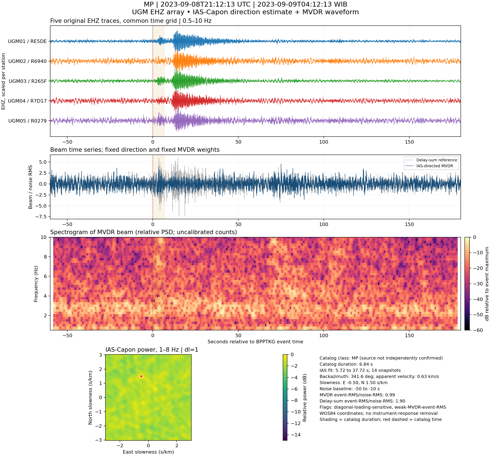

[PNG penuh](figures/20230908T211213_MP_row43260.png) · [EHZ asli 100 Hz](waveforms/20230908T211213_MP_row43260_EHZ_RAW.mseed) · [EHZ proses 25 Hz](waveforms/20230908T211213_MP_row43260_EHZ_25Hz.mseed) · [Beam MVDR dan delay-sum](beam_products/20230908T211213_MP_row43260_BEAMS.mseed) · [Metadata](metadata/20230908T211213_MP_row43260.json)

## 20230908T205830_ROCKFALL_row43266

Status: **perlu review**. MVDR event-RMS/noise-RMS <3; diagonal-loading-sensitive; weak-MVDR-event-RMS; volcanic-class BAZ outside 350–10 deg.

BAZ 167.5°, kecepatan semu 1.08 km/s, beam RMS SNR 0.93.

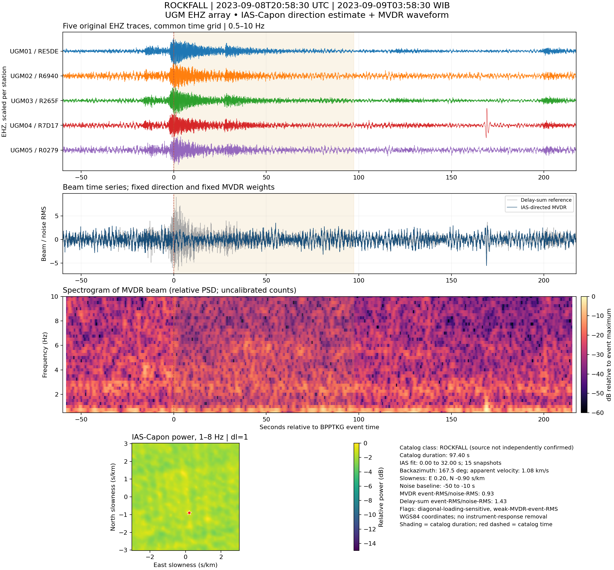

[PNG penuh](figures/20230908T205830_ROCKFALL_row43266.png) · [EHZ asli 100 Hz](waveforms/20230908T205830_ROCKFALL_row43266_EHZ_RAW.mseed) · [EHZ proses 25 Hz](waveforms/20230908T205830_ROCKFALL_row43266_EHZ_25Hz.mseed) · [Beam MVDR dan delay-sum](beam_products/20230908T205830_ROCKFALL_row43266_BEAMS.mseed) · [Metadata](metadata/20230908T205830_ROCKFALL_row43266.json)

## 20230910T213737_ROCKFALL_row42349

Status: **perlu review**. MVDR event-RMS/noise-RMS <3; diagonal-loading-sensitive; weak-MVDR-event-RMS; volcanic-class BAZ outside 350–10 deg.

BAZ 170.5°, kecepatan semu 1.10 km/s, beam RMS SNR 1.07.

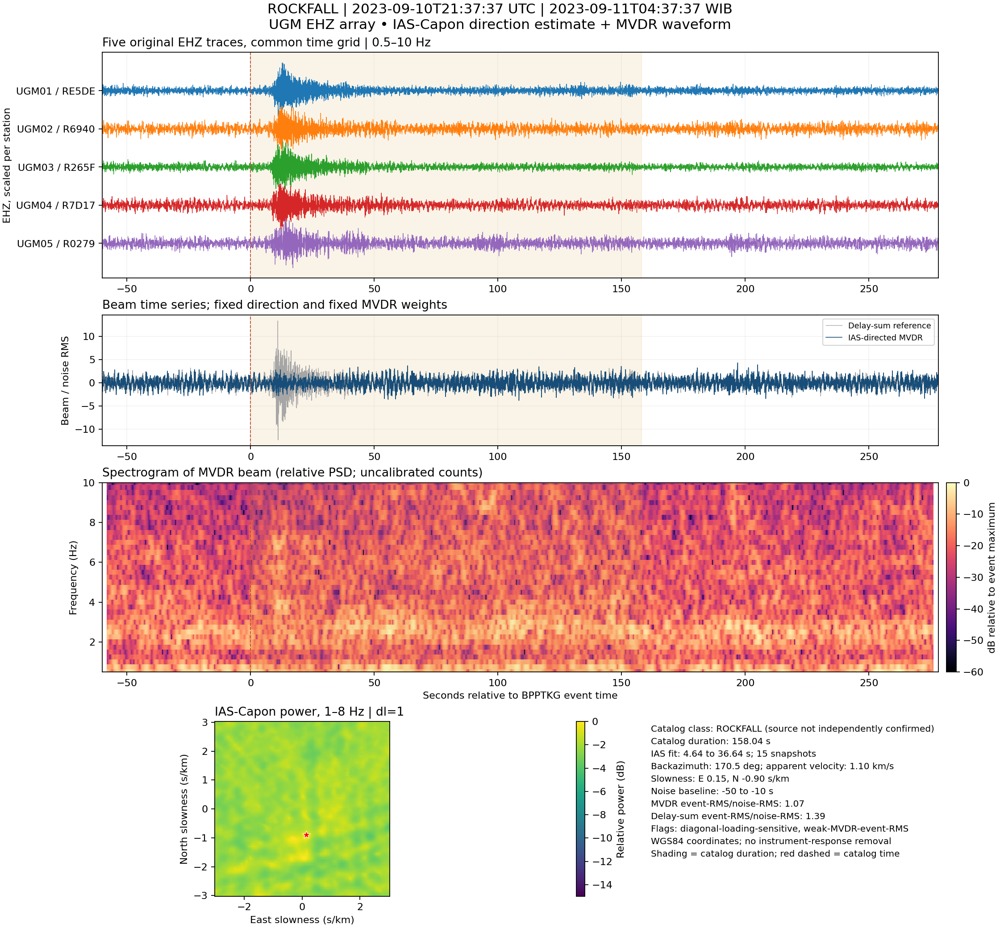

[PNG penuh](figures/20230910T213737_ROCKFALL_row42349.png) · [EHZ asli 100 Hz](waveforms/20230910T213737_ROCKFALL_row42349_EHZ_RAW.mseed) · [EHZ proses 25 Hz](waveforms/20230910T213737_ROCKFALL_row42349_EHZ_25Hz.mseed) · [Beam MVDR dan delay-sum](beam_products/20230910T213737_ROCKFALL_row42349_BEAMS.mseed) · [Metadata](metadata/20230910T213737_ROCKFALL_row42349.json)

## 20230910T181211_ROCKFALL_row42418

Status: **perlu review**. MVDR event-RMS/noise-RMS <3; weak-MVDR-event-RMS; volcanic-class BAZ outside 350–10 deg.

BAZ 226.6°, kecepatan semu 0.40 km/s, beam RMS SNR 0.95.

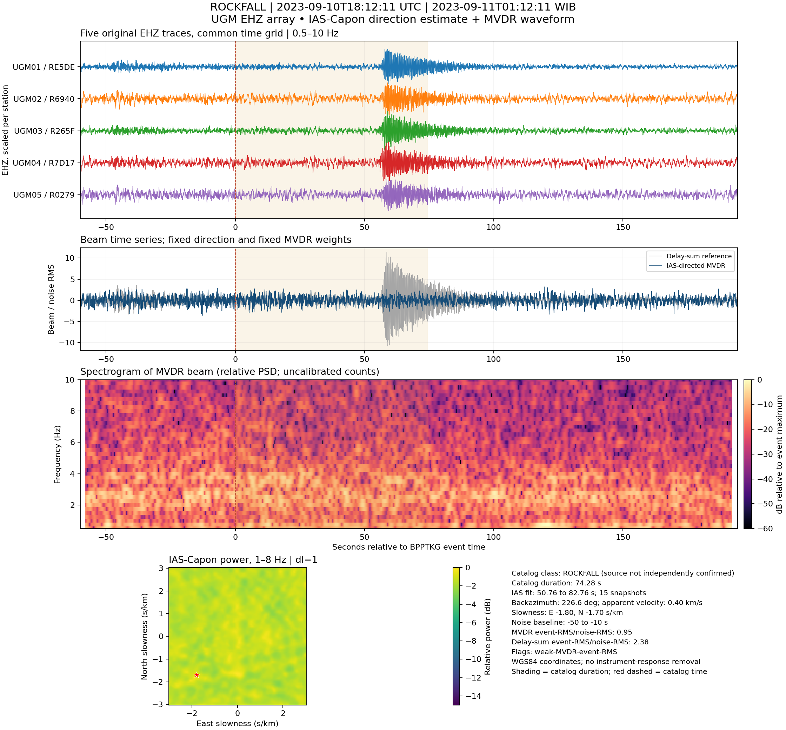

[PNG penuh](figures/20230910T181211_ROCKFALL_row42418.png) · [EHZ asli 100 Hz](waveforms/20230910T181211_ROCKFALL_row42418_EHZ_RAW.mseed) · [EHZ proses 25 Hz](waveforms/20230910T181211_ROCKFALL_row42418_EHZ_25Hz.mseed) · [Beam MVDR dan delay-sum](beam_products/20230910T181211_ROCKFALL_row42418_BEAMS.mseed) · [Metadata](metadata/20230910T181211_ROCKFALL_row42418.json)

## 20230910T123644_VTB_row42559

Status: **perlu review**. MVDR event-RMS/noise-RMS <3.

BAZ 356.6°, kecepatan semu 1.17 km/s, beam RMS SNR 2.99.

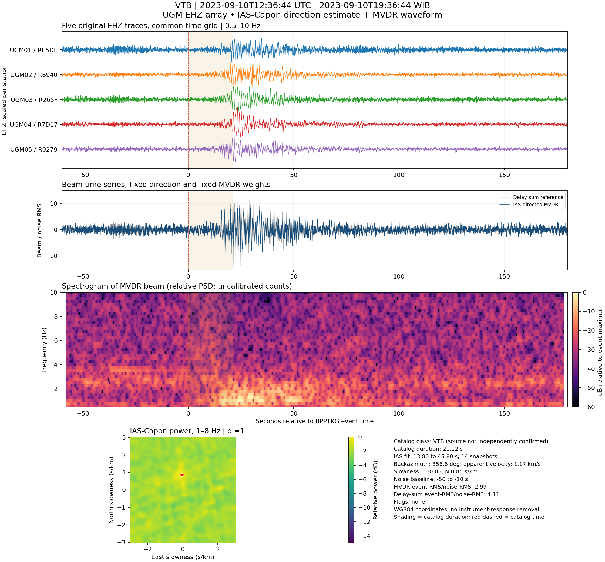

[PNG penuh](figures/20230910T123644_VTB_row42559.png) · [EHZ asli 100 Hz](waveforms/20230910T123644_VTB_row42559_EHZ_RAW.mseed) · [EHZ proses 25 Hz](waveforms/20230910T123644_VTB_row42559_EHZ_25Hz.mseed) · [Beam MVDR dan delay-sum](beam_products/20230910T123644_VTB_row42559_BEAMS.mseed) · [Metadata](metadata/20230910T123644_VTB_row42559.json)

